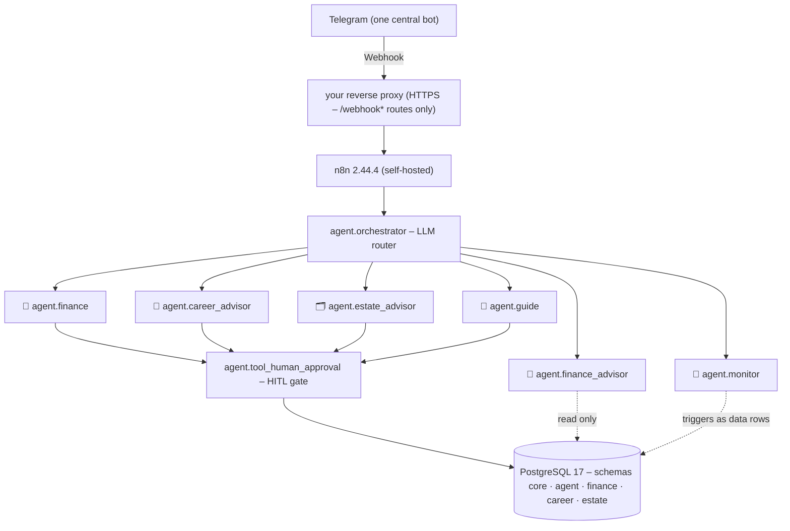

# n8n-life-agents

[](https://github.com/DennisBaerlin/n8n-life-agents/actions/workflows/ci.yml)
[](LICENSE)

**Your household's bookkeeping, deadline reminders and advice on money, career and estate planning — all through one Telegram bot. Self-hosted on your own hardware, and nothing is ever saved before you approve it with a tap.**

Write to the bot in any language — it answers in yours. Behind the scenes a router picks the right specialist; you never notice and just start typing.

→ **[Documentation site](https://dennisbaerlin.github.io/n8n-life-agents/)** (German) · [Installation](#installation) · [Contributing](CONTRIBUTING.md) · [Security](SECURITY.md)

**What it feels like:**

```
You: I paid €45.90 at Rewe for groceries today, from my checking account.
Bot: Book expense – please check:
     • Account: Checking · Amount: €45.90 · Category: Groceries · Date: 02.07.2026
     [✅ Confirm] [❌ Cancel]
You: (taps ✅)
Bot: Booked. New balance Checking: €1,234.56
```

Personal project · self-hosted · specialist agents on n8n 2.44.4 + PostgreSQL 17.

## What it is — and who it is for

You talk to a single Telegram bot, like a contact you already know. Behind it runs a small machine that belongs only to you (a Debian server at home, not someone else's cloud). Everything you tell the bot ends up in your own database there.

When you write, a router (the "orchestrator") reads the message and hands it to the right specialist — the bookkeeper, the financial advisor, or whoever you need. **Before anything is stored** — a booking, a plan change, a remembered fact — the bot shows you exactly what it is about to do. Only after you tap ✅ is it written, and then completely or not at all.

The system has a fixed core (router, approval logic, memory, onboarding) plus one pluggable **package** per area of life — today finance, career, estate planning and documents. A new area plugs in without touching the core.

**Who it is for:** people who already run (or want to run) a small home server, are comfortable with a terminal and a reverse proxy, and want an AI assistant for their household whose data stays at home. Household members you invite need nothing but Telegram.

**Good to know before you start:** this is built for a household in **Germany**. Several features assume German conditions — German tax and estate-planning terms, deadlines computed with the public holidays of your federal state (*Bundesland*), and the job scan via the German Federal Employment Agency (*Bundesagentur für Arbeit*). The bot talks in any language, but the documentation site is German.

## The agents at a glance

| | Agent | What it does |
|---|---|---|
| 🚪 | `agent.guide` | **The start:** walks you through onboarding (household first, then each specialist takes over its topic), answers `/help` and — only if switched on — suggests facts worth remembering once a day, each stored only after individual approval. |
| 📒 | `agent.finance` | **Bookkeeper:** books accounts, expenses, transfers, securities, interest, loans, insurance and savings goals; keeps balances up to date automatically; looks up the current interest rate on the web on request (with source and date). One entry = one approval; the database checks every value before the card is shown. Several entries or a statement as photo/PDF → bulk import with one approval that shows every entry with all fields (after a dry run that reports what would fail). |
| 🔭 | `agent.monitor` | **Reminders:** watches whatever you ask it to (threshold, drawdown, due date, recurrence) and speaks up exactly then. Deliberately gives no advice — that is the advisors' job. |
| 🧭 | `agent.finance_advisor` | **Financial advisor:** knows your plan and your real accounts, answers "is the money enough?", researches with dated sources and only reports new deviations. Never books anything. |
| 💼 | `agent.career_advisor` | **Career coach:** CV photo → profile, career plan, weekday job scan that learns from 👍/👎, skill gaps — and "can I afford the switch?" based on your real liquidity. |
| 🗂️ | `agent.estate_advisor` | **Estate-planning advisor:** keeps the emergency register (powers of attorney, contracts, digital accounts, contacts — only where things are, never passwords), produces the **emergency folder** as a document you can hand on, and guides you gently through a checklist with database-computed deadlines when a death or emergency happens. No legal advice. |
| 📄 | `agent.paperless_assistant` | **Document assistant:** finds, reads and queries your scanned papers in your existing **Paperless** instance ("When does my ID card expire?") — read-only, adults only, always with source. The bookkeeper, advisors and estate advisor use the same three tools. |

## Requirements and running costs

- A fresh **Debian 12** LXC container or VM.
- A **domain** pointing to it and **public reachability**: port forwarding (443) plus an HTTPS **reverse proxy** you bring yourself (NPM, Traefik, nginx, Caddy — on the host or elsewhere in your network). The installer asks where it runs and prints a ready-made configuration.
- A **Telegram bot token** from @BotFather.
- An **Anthropic API key** (required — every agent runs on Claude).
- Optional: a **Google Gemini API key on the paid tier**, only for voice messages. Without it the bot asks you to type instead.

**Costs:** there is no subscription. You pay for your own hardware and for AI usage by consumption, billed directly by Anthropic (and Google, if you use voice messages). The model choice is deliberately frugal: routing and plan reminders run on Haiku, bookkeeping, help, monitoring, web search, reading documents and job scoring on Sonnet, and only the advisor agents on Opus. A local gateway on your server adds prompt caching for every agent (the identical start of each request costs only a fraction when re-read) and counts tokens — never content.

## Installation

On the fresh Debian machine, as root, this one command downloads and starts the installer:

```bash
curl -fsSL https://github.com/DennisBaerlin/n8n-life-agents/releases/latest/download/install.sh -o install.sh && bash install.sh --domain n8n.example.com
```

The installer then guides you **step by step**, and **all questions come first**: internet address, n8n login, details about you (including the language for the bot's fixed messages), Telegram token, Anthropic and (optionally) Google keys, and which packages to install. A short box before each question explains what it is for and where to get it. Keys are checked online right away, every answer is saved immediately (Ctrl+C and a re-run only asks for the rest), and a final **summary** lets you confirm, change a single answer or cancel. After that everything runs without further questions: one line per step, technical details in `/var/log/lifeagents/install.log` (`--verbose` shows everything).

At the end the installer checks whether Telegram can reach your server — if not, you get a **ready-made Caddyfile** for your reverse proxy and can re-check after setting it up. It then shows a **pairing link** (`t.me/<your-bot>?start=…`), waits until you open it in Telegram and finishes configuring the bot for you.

Step-by-step guide including reverse proxy, router (FritzBox) and Telegram bot setup: **[Installation page](https://dennisbaerlin.github.io/n8n-life-agents/docs/installation.html)** (German).

<details>
<summary><strong>What the run does in detail</strong></summary>

`install.sh` downloads the release, verifies its SHA256 checksum and hands over to the actual installer (`provision.sh`). It installs PostgreSQL 17 and n8n 2.44.4, loads the database schema and seeds, sets up the owner, injects the credentials, deploys the core workflows and installs the operations CLI (packages: `--packages all|a,b`, or later `lifeagents package install`). HTTPS is provided by your own reverse proxy. Pin a specific version with `--version vX.Y.Z`. Schedules and "today" run in the household time zone (default Europe/Berlin, configurable via `HOUSEHOLD_TIMEZONE`), never in the container clock. Flow and release process: [provisioning/CLAUDE.md](provisioning/CLAUDE.md).

</details>

<details>
<summary><strong>The <code>lifeagents</code> operations CLI</strong> (on the instance)</summary>

```bash
lifeagents                           # no command (terminal): interactive menu — arrow keys + Enter
lifeagents update                    # self-update: latest release + DB migration (core + installed packages)
lifeagents package list|install|reconfigure …  # install/uninstall packages individually
lifeagents reconfigure [core|<pkg>]  # change or add settings (address, bot token, keys) and re-apply
lifeagents config list|set|reset …   # central runtime config
lifeagents proxy show|set …          # reverse proxy status + configuration
lifeagents household …               # invite/pair/remove/block members
lifeagents backup export|restore …   # encrypted full backup, optionally to Telegram
lifeagents rollback                  # after a failed update: back to the previous version (asks first)
lifeagents doctor                    # read-only health check
lifeagents uninstall [--purge-data]  # clean removal
lifeagents version                   # installed release version
lifeagents help                      # THE complete reference (per area: lifeagents <command> help)
```

The help output is the **one** command reference (lint-checked against the code — `contract_lint` check 13); this list is only an overview. Installer flags (including `--unattended`): `install.sh --help` or `provision.sh --help`.

</details>

## Using it

Just write to the bot the way you would write to a person, in any language. There are no commands to memorise for booking, asking or getting advice. Fixed texts — greeting, approval cards, buttons, `/help`, the `/onboarding` menu and everything the bot sends on its own (reminders, advisor notes, job cards, emergency folder) — come in each person's chosen language (Deutsch, English or 한국어), switchable with `/language`.

A few fixed commands exist for special cases: `/start [code]` (first contact or redeeming an invitation code), `/help`, `/onboarding` (back to the setup steps), `/language`, `/persona` (pick the bot's character: neutral, butler, sports commentator or wise sage — it only flavours greetings, small talk and at most one sentence around an answer; numbers, cards and buttons stay neutral), `/reminders` (everything the bot sends on its own, switchable per tap) and `/notfall` (starts the estate advisor directly in an emergency).

Whenever the bot needs a decision, you get **buttons**: ✅/❌ to confirm or cancel, 👍/👎 for job suggestions, on/off switches. While an approval card is open the bot accepts no new message — tap ❌ first, then write your correction; the assistant still knows the cancelled card. Attachments work too: a bank statement PDF runs the **monthly check**, a photo of a portfolio statement or insurance policy becomes one approval card, a CV goes to the career coach, and voice messages are transcribed and handled like text.

**Updates in the chat:** the bot announces new releases with a short summary; one tap on *Update now* installs it — backup first, then a result message with help if something fails (way back: `lifeagents rollback`).

## Security and privacy

- **Nothing is saved without asking.** Every booking, change or deletion shows all values first, including automatically added ones. In a household, members approve harmless things themselves, sensitive ones additionally need the owner (four-eyes principle), and some (financial plan, identity) only the owner may change.
- **All or nothing.** Every write runs in one database transaction — never half a booking.
- **Documents only via paid AI endpoints.** All agents use Claude through the paid Anthropic API, including reading statements, CVs and Paperless documents. Only voice messages are transcribed by Google Gemini, and only on the paid tier. Both providers state that they do not train on data from paid access.
- **No secrets in the code.** Keys live in the n8n credential store or on the server, never in the repository; the backup key is created in the database during installation.
- **Strangers do not get in.** The bot only reacts to Telegram accounts that were explicitly admitted. Backups can be sent encrypted to your own Telegram chat.
- **Signed releases.** Updates are only applied with a valid project signature (`gpgv`, offline key).

Reporting a vulnerability: [SECURITY.md](SECURITY.md) (private, no public issues).

---

*From here on it gets technical — for developers and the curious.*

## Architecture (for developers)

Three decisions make the difference: **the model proposes — the database decides** (no agent computes balances, rates or signs; every derived number is computed by the database, every rule enforced by a constraint). **Every message travels a one-way DAG** (agents never call agents; a depth latch stops loops before the expensive model call). **Every area of life is an isolated package** (own schema, own roles, own manifest — packages only share a deliberately published read window).

<details>
<summary><strong>Diagram + details</strong></summary>



- The orchestrator's routing is **generated at build time from the package manifests** — a new agent needs no orchestrator edit.
- Every domain package owns exactly one database schema and its own isolated read/write roles; cross-access only via deliberately published read windows.
- Memory has four layers (always-loaded instructions · lazily loaded knowledge docs · chat history per agent · structured domain tables) — details in [CLAUDE.md](CLAUDE.md).

</details>

## Documentation map

The README stays an overview — details live at exactly one address:

- **Documentation site (German, for users and operators):** <https://dennisbaerlin.github.io/n8n-life-agents/> — landing page with example chats plus docs (getting started, usage, agents, security, operations). Source in `docs/site/`; `docs/site/public/index.html` also opens offline by double-click.
- **Dev setup and enforcement gates:** [CONTRIBUTING.md](CONTRIBUTING.md); conventions in short for contributors and coding agents: [AGENTS.md](AGENTS.md).
- **Architecture and conventions (German):** the [CLAUDE.md](CLAUDE.md) family plus per-area files in [packages/](packages/CLAUDE.md), [scripts/](scripts/CLAUDE.md), [tests/](tests/CLAUDE.md), [provisioning/](provisioning/CLAUDE.md), and mechanics per area in [docs/reference/](docs/reference/). They are written as the working memory for AI-assisted development (Claude Code), but give human readers the full picture too.
- **Package contract (what an area-of-life package must provide):** [docs/package-contract.md](docs/package-contract.md)
- **Planned / deliberately deferred:** [BACKLOG.md](BACKLOG.md)

## Stack and quality

n8n 2.44.4 · PostgreSQL 17 · reverse proxy (recommended: Caddy, bring your own) · Bash provisioning · PowerShell dev tooling · Docker test substrate · Telegram Bot API · Anthropic Claude for all language work, Google Gemini only for voice transcription.

Quality is enforced by tools, not discipline: five test tiers (deterministic DB tests up to end-to-end with real writes), local prek hooks identical to CI, secret scans over the full history. The current numbers live in the test and CI files themselves — deliberately none here that would go stale.

## Project status and support

This is a personal project, built for and used in one household, and shared as-is so you can run your own instance. There is **no support**: the issue tracker is switched off, and pull requests are not actively reviewed. The only inbound channel is GitHub's private vulnerability reporting for security problems ([SECURITY.md](SECURITY.md)). Forks are welcome under the license.

## License and notices

- Code and documentation are licensed under the [MIT License](LICENSE).
- **Not an official n8n project.** n8n is a trademark of n8n GmbH; this project is not affiliated with or endorsed by n8n.
- **n8n itself is not part of this repository.** It is licensed under n8n's [Sustainable Use License](https://docs.n8n.io/sustainable-use-license/), which is not an OSI open-source license; the installer installs n8n from its official npm package on your machine and does not redistribute it.
- **No financial, tax or legal advice.** The agents give information and suggestions; decisions and their consequences remain yours. The software comes without any warranty (see the license).
